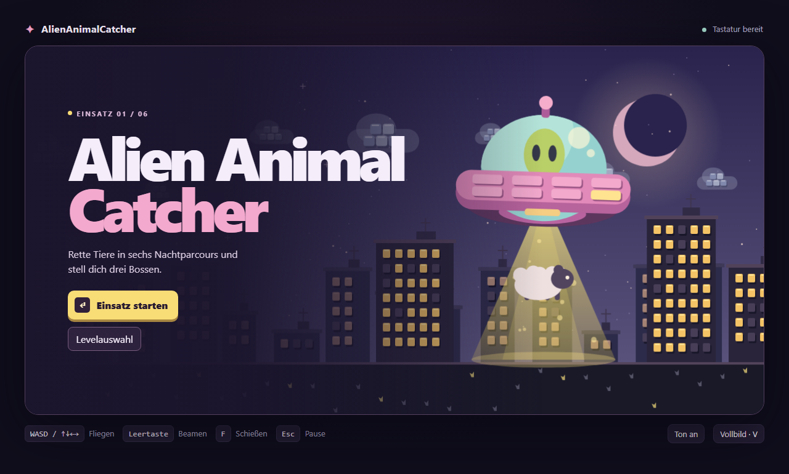

# 🛸 AlienAnimalCatcher

Flieg mit einem rosa UFO durch die Nacht, beam Schafe, Kühe und Schweine an Bord und bring sie sicher nach Hause. Das Spiel ist im Stil einer Mosaik-Postkarte gestaltet und läuft offline im Browser und auf Android.

[](https://github.com/dominikamon-kirbio/AlienAnimalCatcher/actions/workflows/android.yml)



[Im Browser starten](#im-browser-starten) · [Android installieren](#android-installieren) · [Steuerung](#steuerung) · [Android lokal bauen](#android-lokal-bauen)

## Deine Mission

Rette **47 Tiere** in sechs Nachtparcours. Der Ausgang öffnet sich, sobald alle Tiere des Parcours an Bord sind. Aus der Levelauswahl kannst du alle neun Missionen direkt starten.

| Abschnitt | Parcours | Boss |
| --- | --- | --- |
| 1 | Dächer bei Nacht · Nebel über dem Moor | **Der Sternenjäger** feuert immer dichtere Salven. |
| 2 | Mondhafen · Sternenweide | **Die Rache der Kuh** trifft ganze Reihen und Spalten mit Beamstrahlen. |
| 3 | Polarstation · Riss im Sternenmeer | **Vexa, das Schattenalien** markiert Einschlagszonen und schickt Energiegeschosse vom Arenarand. |

Die ersten Parcours führen an Patrouillendrohnen vorbei. Später unterbrechen Störsender deinen Fangstrahl, bis ihr violettes Feld erlischt. Geschütztürme kündigen Schüsse mit einer Ziellinie an. Im letzten Abschnitt musst du allen drei Gegnertypen ausweichen.

## Im Browser starten

Lade das Projekt über **Code → Download ZIP** herunter, entpacke es und öffne `index.html` in einem aktuellen Browser. Es gibt keine Installation und keinen lokalen Server.

## Android installieren

1. Öffne den [letzten erfolgreichen Android-Build für `main`](https://github.com/dominikamon-kirbio/AlienAnimalCatcher/actions/workflows/android.yml?query=branch%3Amain+is%3Asuccess).
2. Lade unter **Artifacts** das ZIP **AlienAnimalCatcher-Android** herunter. Melde dich bei GitHub an, falls der Download nicht angezeigt wird.
3. Entpacke das ZIP und installiere `AlienAnimalCatcher.apk` auf einem Gerät mit **Android 8.0 oder neuer** und aktuellem Android System WebView.

Die Debug-APK ist für die Direktinstallation gedacht. Die App startet im Querformat.

## Steuerung

| Aktion | Tastatur | Xbox-Controller | Touch |
| --- | --- | --- | --- |
| Fliegen | WASD oder Pfeiltasten | Linker Stick oder Steuerkreuz | Joystick links |
| Tiere beamen | Leertaste halten | A oder RT halten | **Beamen** halten |
| Im Bosskampf schießen | F halten | X oder RB halten | **Schießen** halten |
| Pause | Esc | Menü-Taste | Pause-Knopf |
| Levelauswahl | Knopf im Menü | Y | Knopf im Menü |
| Vollbild im Browser | V | View | **Vollbild** |

## Android lokal bauen

Öffne `android/` in Android Studio oder führe den Gradle Wrapper mit **JDK 17**, **Android SDK 35** und **Build Tools 34.0.0** aus.

```bash
cd android
./gradlew :app:assembleDebug :app:lintDebug
```

Unter Windows verwende `.\gradlew.bat` anstelle von `./gradlew`. Die APK liegt danach unter `android/app/build/outputs/apk/debug/app-debug.apk`.

Browser und Android teilen sich die Canvas-Spielengine in `game.js`. Der Android-Build verpackt HTML, CSS und JavaScript direkt aus dem Projektstamm.
